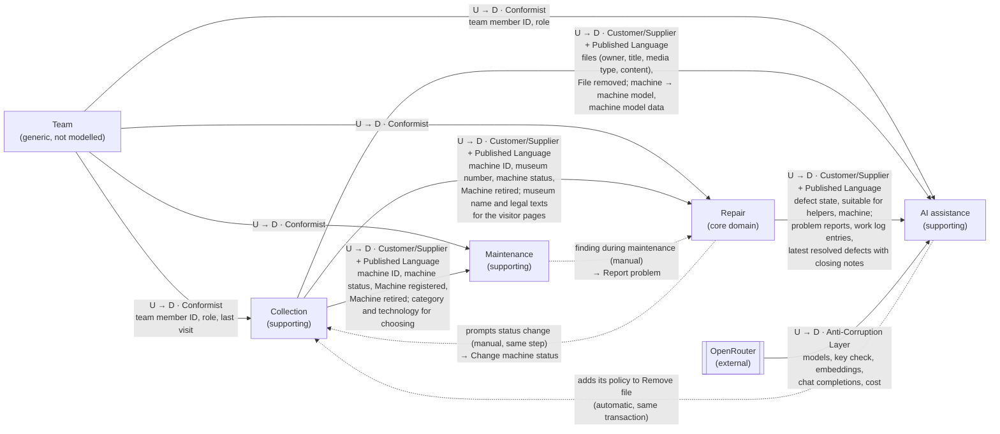

# Context Map

> Source: `docs/domain/events.yaml` (`bounded_contexts`, `aggregates`, `policies`, `read_models`), `docs/product/vision.md`. Glossary: `CONTEXT.md`. As of: 2026-10-31 (AI assistance, feature ai-assessment; museum settings, feature museum-start-page)

## Contexts

| Context | Kind | Purpose | Core terms | Owner role | Aggregates |
|---|---|---|---|---|---|
| **Repair** (`BC-Repair`) | Core domain | From problem reports via triage to defects that are worked on and resolved – the reason La Guardia exists ("no defect gets lost", traceable repair history) | Problem report, Triage, Defect, Priority, Resolved on the spot, Claim, On hold, Closed on retirement, Work log entry, Repair history | Technician (triage, priority); every team member works on defects | `AGG-ProblemReport`, `AGG-Defect` |
| **Collection** (`BC-Collection`) | Supporting | Which machines the museum has, what they are, where they stand, whether they are playable, and their files – and how the museum presents itself to visitors (museum settings) | Machine, Machine model, Machine category, Technology, Museum number, Serial number, Location, Machine status, Registered / Retired machine, File, File category; Museum settings, Logo, Legal texts, Welcome page | Technician (registration, machine status, file removal, museum settings); helpers may set *Out of order* and attach files | `AGG-Machine`, `AGG-MachineModel`, `AGG-File`, `AGG-MuseumSettings` |
| **Maintenance** (`BC-Maintenance`) | Supporting | The maintenance plan and keeping every machine's scheduled maintenance up to date | Maintenance task, Machines of a maintenance task, Maintenance plan, Due / Overdue, Maintenance record, Suitable for helpers | Technician (maintenance plan); every team member records maintenance | `AGG-MaintenancePlan`, `AGG-MaintenanceRecord` |
| **AI assistance** (`BC-AiAssistance`) | Supporting | Asking an AI for help with open defects: the AI settings, the AI index of the machines' and machine models' files, and AI assessments of defects (feature ai-assessment) | AI settings, Chat model, Embedding model, AI index, AI index entry, AI assessment, Reference | Technician (AI settings, retrying a failed file); every team member who may work on an open defect requests AI assessments | `AGG-AiSettings`, `AGG-AiIndexEntry`, `AGG-AiAssessment` |
| **Team** | Generic, **not modelled** | Team member accounts, roles (helper / technician), signing in and last visit | Team member, Account, Helper, Technician, Last visit | Technician (manages accounts, `docs/product/vision.md`) | – (standard account management, see `docs/adr/0004-team-authentication.md`) |

The **Visitor** is not a context and has no account: visitor pages are a public view onto Collection and Repair (`RM-VisitorMachinePage`) plus the *Report problem* command of Repair. The welcome page (`RM-WelcomePage`) and the legal pages (`RM-LegalPage`) read Collection only – museum settings, machines and machine models; the hint *Out of order* / *Limited* is the machine status, not Repair data.

**Why museum settings live in Collection (feature museum-start-page, 2026-10-31):** they are a handful of values technicians change rarely, with no language of their own that would clash with another context, and their only domain neighbour is Collection's list of machines on display. A fifth context would add a boundary without a reason; Collection already owns what visitors see of the museum's machines. Repair does not own them either: it reports problems, it does not present the museum.

**Why AI assistance is a context of its own (feature ai-assessment, HS-28, 2026-10-31):** unlike the museum settings it has a language of its own that no other context uses (chat model, embedding model, AI index, AI index entry, AI assessment, reference) and an external system only it talks to (OpenRouter). Its parts would otherwise be spread over two contexts that must not know it: an AI assessment never changes a defect, so it is no part of the defect's consistency boundary, and putting it in Repair would make Repair read Collection's files and depend on OpenRouter; the AI index follows the files, but Collection is upstream of everything and stays free of AI (ADR 0002, ADR 0010). The AI settings sit on the same settings page („Einstellungen“) as the museum settings – a page is not a context – but nothing outside AI assistance reads them.

## Relationships

Solid arrows: upstream (U) supplies, downstream (D) depends. Dotted arrows: the downstream context triggers or extends a command of the other context through a policy – the upstream/downstream direction does not change.

### Collection → Repair (Customer/Supplier, Published Language)
- Collection is upstream: it owns the machine, its identity and its **machine status** (user decision). Repair references machines **by machine ID only** and never stores or changes the status itself.
- Published language: the events `EVT-MachineRegistered`, `EVT-MachineStatusChanged`, `EVT-MachineRetired` and the machine reference (machine ID, museum number).
- Repair reacts **automatically** to `EVT-MachineRetired`: `POL-RetirementClosesDefects` (→ `CMD-CloseDefectOnRetirement`) and `POL-RetirementDismissesProblemReports` (→ `CMD-DismissProblemReport`). Collection does not know them: Repair adds them to Collection's command (ADR 0010).
- Repair reads from Collection when checking command rules that are not its own invariants: *Report problem* (visitors only for machines on display, nobody for retired machines), *Reopen defect* (machine not retired). These are checks against the current machine state at command time, not invariants – a machine retired in the same second is caught by the retirement policies, because these reads take the machine's retirement lock shared and the retirement takes it exclusively (`docs/adr/0010-cross-module-policies-and-retirement-lock.md`).
- Repair's visitor pages (the visitor machine page, the report form) read the **museum settings** for what every visitor page shows: the museum name where a page names the museum, and the links to the legal texts – the imprint link only when an imprint is provided. Read-only; only technicians change the museum settings, through Collection's commands (`CMD-ChangeMuseumDetails`, `CMD-ReplaceLogo`, `CMD-RemoveLogo`, `CMD-ChangeLegalTexts`). Collection knows nothing of Repair for it.
- Repair prompts status changes **manually**: `POL-DefectMayChangeMachineStatus` (new or reopened defect – the technician sets *Limited* / *Out of order* in the same step, HS-3) and `POL-ResolvedDefectsReturnMachineToPlay` (machines without open defects highlighted, the technician decides on *Playable*, HS-6). Both issue Collection's `CMD-ChangeMachineStatus`; the decision stays with the technician.

### Collection → Maintenance (Customer/Supplier, Published Language)
- Which maintenance tasks apply to a machine is Maintenance's own decision: the **machines of a maintenance task**, chosen by a technician and referenced by machine ID (`EVT-MachinesOfMaintenanceTaskChanged`, FLOW-PerMachineMaintenance, 2026-10-25). Collection's machine category and technology no longer decide it; Maintenance reads their **current** values only to group machines in `RM-MachineChoiceForMaintenanceTask` and to propose maintenance tasks for a new machine in `RM-MaintenanceTaskChoiceForMachine`. A machine model correction changes nothing in Maintenance; the category history (ST-036) is no longer read after the migration (HS-23, HS-24).
- Maintenance needs the machine status history, because machines that are *Not on display* never become due (HS-13, HS-20).
- `EVT-MachineRetired` removes the machine from due maintenance and from every choice by derivation – Maintenance adds no policy to the retirement (ADR 0010 stays as it is). `CMD-RecordMaintenance` checks that the machine is not retired (under the retirement lock); `CMD-ChangeMachinesOfMaintenanceTask` checks that a machine added is registered and not retired.
- **Registration with chosen maintenance tasks** (HS-22): Maintenance adds `POL-RegistrationAppliesChosenMaintenanceTasks` to Collection's `CMD-RegisterMachine` (ADR 0010 – the downstream module adds its policy; Collection does not know it). The chosen tasks are the technician's input to that policy for the one registration, never data of the registration command or of `EVT-MachineRegistered`; the policy takes the new machine ID from the event and runs `CMD-ChangeMachinesOfMaintenanceTask` once per chosen task, in the registration's transaction. A rejected policy (a chosen task removed meanwhile) rejects the registration – stored together or not at all.

### Maintenance → Repair (manual)
- `POL-MaintenanceFindingIsReported`: a fault found during maintenance becomes a problem report through Repair's normal `CMD-ReportProblem`. Maintenance has no knowledge of defects.

### Collection → AI assistance (Customer/Supplier, Published Language)
- AI assistance references files, machines and machine models **by ID only**. Collection publishes narrow queries for it: the files that are not removed (owner – machine or machine model –, title, file category, media type, content reference), a machine's machine model, and the machine model's title, manufacturer, year, machine category and technology. The content itself is read through the storage seam (ADR 0012) by the content reference – never through Collection's tables.
- **Attaching a file** (`POL-AttachedFileIsIndexedForAi`) needs nothing from Collection's command: the page that attaches a file starts AI assistance's background work after the response, and that work finds every file without an AI index entry for the current embedding model as *waiting* (ADR 0015). Collection does not know it.
- **Removing a file** (`POL-RemovedFileLeavesAiIndex`, HS-29) happens in the same transaction: AI assistance adds its policy to Collection's `CMD-RemoveFile` with `withPolicies` and exports the composed command, which the file pages use (ADR 0010, option 3 – the downstream module adds its policy). AI assistance is the only module reacting to `CMD-RemoveFile`, so ADR 0010's option 4 (a neutral composition element) is not triggered. The policy runs also while AI is off.
- **The file's removal lock** (ADR 0014): an indexing reads its file for a long time outside any transaction and stores the AI index entry in a short one at the end. Collection's read for that last step takes the file's lock **shared**; `CMD-RemoveFile` takes it **exclusively**. An indexing that stores while the removal runs waits and then reads *removed* (it records nothing); a removal that starts while an indexing stores waits and its policy then removes the new entry. The pattern and the reason are those of the machine's retirement lock (ADR 0010); it is the second named exception to "a read of another module takes no lock".
- A **retired machine** changes nothing in AI assistance: its files stay files and stay in the AI index; its defects are closed, so no new AI assessment can be requested for them. No policy on `EVT-MachineRetired`.
- A **machine model correction** changes nothing either: AI index entries keep the file's owner, which never changes (`AGG-File`); which machine model a machine has is read when an AI assessment is written.

### Repair → AI assistance (Customer/Supplier, Published Language)
- AI assistance references defects **by ID only**; an AI assessment never changes a defect (`docs/product/vision.md`), so Repair has no command AI assistance runs and no policy of AI assistance on Repair's commands.
- **Requesting** (`CMD-RequestAiAssessment`) reads Repair's public query for the defect in its facts – open, on hold, resolved or closed on retirement; suitable for helpers; its machine – at command time **without a lock** (engineering conventions, *A rule that needs another module's data*). No lock is needed: a defect resolved or closed on retirement right after the request does not stop the AI assessment (HS-30). The machine is not read: a retired machine's defects are closed.
- **Writing** (`CMD-WriteAiAssessment`) reads what it sends through Repair's public queries – the defect's title, priority and hold reason, its problem reports' descriptions and photos (visitors' included), its work log entries, and the machine's latest resolved defects with their closing notes – outside any transaction, as plain data. Photos are read through the photo module.
- Repair does not know AI assistance. The defect page and the machine record are composed in the app: Repair's read models plus AI assistance's `RM-DefectAiAssessments` and the AI index state of each file.

### OpenRouter → AI assistance (Anti-Corruption Layer)
- OpenRouter is the only AI backend (`docs/product/vision.md`, Constraints). Only AI assistance talks to it, through one adapter behind a seam (ADR 0014): the model list (name, context size, price, accepted inputs), the key check, embeddings for text and images, chat completions with images, and the cost of each request.
- The layer turns OpenRouter's answers into the domain's language – the reasons of `EVT-FileIndexingFailed` (*OpenRouter refused*, *OpenRouter not reachable*) and `EVT-AiAssessmentFailed` (*key invalid*, *credit used up*, *model not available*, *timed out*, *OpenRouter not reachable*) – and every request asks only for providers that neither keep nor train on the data (ADR 0014). Nothing reaches OpenRouter while AI is off.

### Team → all contexts (Conformist)
- All contexts use the Team area's **team member ID** as the only reference to people (`Reported by`, `Claimed by`, `Recorded by`, …) and its **role** (helper / technician) for permission rules, e.g. "Helpers can only claim defects suitable for helpers", "Helpers can only set Out of order".
- The dashboards use the viewer's **last visit** from the Team area – the previous time they opened their dashboard – for the field *New since last visit* in `RM-TechnicianDashboard` and `RM-HelperDashboard` (HS-21). Not the last sign-in: team members stay signed in for weeks, so it would mark almost nothing as new.
- Team is deliberately not modelled as a domain: it is standard account management (`docs/adr/0004-team-authentication.md`).

## Cross-context read models

Read models compose data from several contexts; they only read, every write goes through the owning context's commands (`docs/adr/0002-modular-monolith-state-based-persistence.md`).

| Read model | Collection | Repair | Maintenance | AI assistance | Team |
|---|---|---|---|---|---|
| `RM-VisitorMachinePage` | x | x | | | |
| `RM-TriageList` | x | x | | | x |
| `RM-OpenDefects` | x | x | | | x |
| `RM-MachineOverview` | x | x | x | | |
| `RM-MachineRecord` | x | x | x | x | x |
| `RM-DueMaintenance` | x | | x | | |
| `RM-MaintenancePlan` | x | | x | | |
| `RM-MachineChoiceForMaintenanceTask` | x | | x | | |
| `RM-MaintenanceTaskChoiceForMachine` | x | | x | | |
| `RM-TechnicianDashboard` | x | x | x | | x |
| `RM-HelperDashboard` | | x | x | | x |
| `RM-RepairTimes` | | x | | | |
| `RM-WelcomePage` | x | | | | |
| `RM-LegalPage` | x | | | | |
| `RM-MuseumSettings` | x | | | | |
| `RM-AiSettings` | x | | | x | |
| `RM-DefectAiAssessments` | x | x | | x | x |

`RM-AiSettings` reads Collection for the files waiting and failed (title, machine or machine model); `RM-DefectAiAssessments` reads Repair for whether the defect is open and suitable for helpers (*May request*), Collection for the titles of referenced files (a removed one without a link) and Team for *Requested by*. Both live in AI assistance; the pages compose them with Repair's and Collection's read models.

## Open points
- AI assistance (feature ai-assessment): HS-28 (which context owns it) is resolved – a context of its own. HS-32, HS-33 and HS-34 are resolved as recommended (user, 2026-10-31).
- Otherwise none affecting a context boundary. HS-25, HS-26 and HS-27 (feature museum-start-page) stay inside the museum settings in Collection. HS-22 (registration with chosen maintenance tasks across Collection and Maintenance) is resolved; HS-24 (which maintenance records count for *Last done*) is open but stays inside Maintenance. HS-18 (events for corrections of location, machine model, museum number and defect title – Collection and Repair) and HS-21 (the Team area records the viewer's last visit for *New since last visit*) are both resolved; see `docs/domain/events.yaml`.
